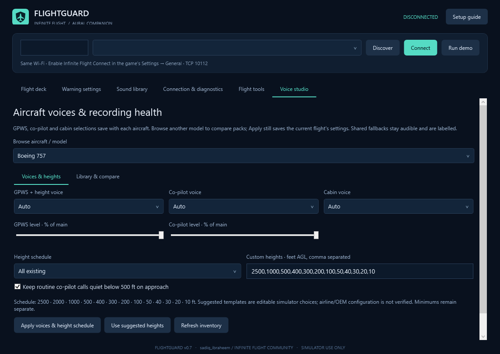
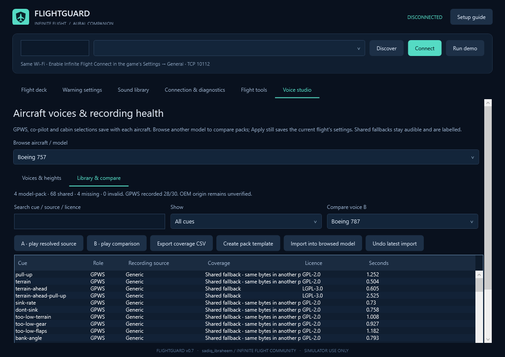

# FlightGuard

Windows companion for Infinite Flight: recorded cockpit callouts, configurable GPWS, forward terrain monitoring, and a cabin experience from boarding to arrival. Created for **sadiq_ibraheem** on the [Infinite Flight Community](https://community.infiniteflight.com/u/sadiq_ibraheem).

Connect your phone/tablet and Windows PC to the same Wi-Fi, start a flight and enable Infinite Flight Connect. Discover the local device or enter its LAN IP. FlightGuard reads [Connect v2](https://infiniteflight.com/guide/developer-reference/connect-api/connect-api) telemetry without a cloud API key or aircraft-control commands.

## Version 0.7 — Aircraft voices and Voice Studio

- Separate GPWS/height, co-pilot and cabin voice choices, saved per aircraft, with independent GPWS and co-pilot volume levels.
- Voice Studio has setup and library/compare pages, A/B preview, search, role/missing/shared filters, clip durations, leading-silence measurements, original hashes and source/licence details. Inventory scans run in the background.
- Authorised personal WAV packs support cue mapping and source metadata, full decode validation before switching, backups and undo. Export an editable pack template or a coverage CSV. Imports require a disconnected live/demo/replay session.
- Editable height schedules: retain the old schedule, choose suggested simulator templates or specify individual heights. Five-foot calls now work when selected and a recording is present. Suggested templates are not certified airline/OEM configurations.
- Optional routine co-pilot suppression below 500 ft on approach; GPWS, speed/height calls and autopilot disconnect retain their priority.
- 72 additional pinned aircraft-project mappings: Boeing 777 (29), DC-10 (22), A340 (15), A380 (4), A350 (1), and one additional MD-11 gear warning. Some share identical source bytes; the inventory identifies this instead of claiming a distinct voice.
- A220 automatic routing no longer silently selects an A320 voice. Shared simulator warnings remain audible where model recordings are missing.

**269 WAV mappings; 17 repair packs with 266 directly downloadable original WAV clips.** No speech synthesis is used by FlightGuard. Exact OEM origin is unverified. The 757 still has four model recordings; A220 has no verified model set in this bundle, and A350 has one model recording. Do not interpret a model folder or an available preview as a complete bespoke OEM pack.




### Use Voice Studio

Connect with the intended aircraft to load its saved preferences. Disconnect to import or undo a sound pack. **Voices & heights** selects role voices, levels and callout schedules; **Apply voices & height schedule** saves them for the current aircraft. The browse-model selector only changes the inventory being inspected; it does not switch the simulator or select another aircraft's saved preferences. **Auto** follows the current flight model during playback. Minimums remain a separate flight setting.

In **Library & compare**, select a cue and play A (the resolved source) or B (the comparison pack). Warning/quiet-phase preview protections remain active. Missing cues stay visual/silent when no fallback recording exists. Export CSV to inspect coverage and licence details. Create a template in a new folder, add permitted WAVs, edit pack.json and fill pack-info.json with author, source and licence; preserve notices. Import targets the browsed model. **Undo latest import** restores its previous pack; repair/download tools can replace imported files with catalog originals, so keep your own source recordings.

Height schedules accept only existing catalog heights, from 2,500 down to 5 ft AGL. The suggested A320 template includes 5 ft; other model templates omit it. These are editable simulator choices, not claims about every airline's equipment configuration. Custom schedules always take precedence. Playback balances peaks and trims leading dead air without changing source WAV bytes.

### New sources and remaining gaps

New pinned sources: [FlightGear 777](https://gitlab.com/sidi762/flightgear-777/-/tree/b0ce71038c371f1ff1df6817bbc9e11789b550d3), [Octal450 DC-10](https://github.com/Octal450/DC-10/tree/91a84131d95eae60c5c3d7127749386f83ba2e82), [A340](https://github.com/FGMEMBERS/A340-600/tree/e47f70357fe68df7b9fd107acddaa9755c75e3e7), [A380](https://github.com/FGMEMBERS/A380/tree/715e972134a2a708115419d2d301b14e8323922a), [A350](https://github.com/FGMEMBERS/A350XWB/tree/04da937ab1ba0b07dabfd71d91aa33eb38316b90) and the existing Octal450 MD-11 source. A340 additions carry GPL-3.0; other new model additions GPL-2.0. Original bytes and full licences are retained. Empty DC-10 placeholders were excluded. Legacy CSeries assets contain Airbus-named material and did not establish authentic A220 warning provenance, so no bespoke A220 set was claimed. Windshear and spoken go-around recordings remain missing. No new detector for unavailable telemetry is inferred from the presence of an audio file.

## Run and tune

Download the Windows ZIP from Releases, extract the whole folder and run `FlightGuard.exe`. A self-contained build requires no Python or separate .NET installation. Keep the folder writable. Close an older FlightGuard copy before starting a newer one to avoid duplicate sound.

Open **Warning settings**. Verify gear/flap gates and V1/VR/V2 for your flight; arm speeds only after checking them. The GPWS landing flap state is an **index, not degrees**. `-1` selects automatic clean-configuration detection; an explicit state uses aircraft stop angles when available. Unknown flap definitions are shown as unverified rather than guessed. Approach-monitor flap settings are separate.

Forward terrain needs valid GPS and terrain tiles. Downloads run in the background and are cached under `Data/TerrainCache`; initial missing data and network failures are shown in status while local GPWS continues. This external elevation model can differ from Infinite Flight, lacks buildings/obstacles and runway geometry, and withholds forecasts when its current ground reference differs by more than 500 ft. It projects the current track/speed/vertical speed, not future pilot inputs. Configured normal touchdown on flat ground is inhibited. It is a simulator approximation, not certified TAWS. See [terrain sources and notices](Release/Terrain-notices/README.md).

Open **Flight tools → Cabin** at the gate, parked with brake set and below 1 kt. Boarding begins after three seconds. Use **Start new boarding leg** or **Boarding complete / pushback** when needed. Observed taxi/departure/arrival history schedules subsequent announcements; actual passengers, tug movement, doors and runway clearance are not inferred. Joining airborne skips boarding. Shared FlyByWire cabin recordings may retain their original aircraft/airline wording. Cabin stays quiet during takeoff/go-around and below 1,500 ft airborne.

## Build on Windows

Requires .NET 8 SDK and Python 3 for asset fetching. The pinned soundfile dependency converts the two retained terrain OGG originals. Branding is checked in; optional regeneration with `make_brand.py` requires Pillow.

```powershell
./build.ps1 -Output ./publish/FlightGuard-v0.7-Windows
python -m pip install -r ./requirements-audio.txt
python ./fetch_sounds.py ./publish/FlightGuard-v0.7-Windows
```

Fetch scripts preserve pinned revisions, originals, licences, provenance and SHA-256 hashes. Audio is fetched separately from the source repository. Keep `Sounds`, `SoundSources` and notices when packaging. Run `--export-coverage app-directory aircraft-reference.txt` after fetching to generate the inventory; CI does this automatically.

CLI automation should use `Start-Process -Wait -PassThru` and check ExitCode because this is a Windows GUI executable:

```text
--self-test report.txt
--verify-recordings app-directory report.json
--verify-audio-priority report.json
--verify-voices app-directory report.json
--render-voices preview.png 1
--verify-terrain-data temporary-cache-directory report.json
--export-coverage app-directory aircraft-reference.txt
--analyze-recording flight.fgflight.jsonl report.json
--verify-replay flight.fgflight.jsonl report.json
--verify-pack pack-catalog.json "Shared Cabin" temporary-app-directory report.json
--make-demo-recording example-flight.fgflight.jsonl
--render preview.png 1
```

Native playback checks need a Windows audio device and run muted. Generated example flights are synthetic. Replay disconnects live telemetry, performs no terrain downloads, uses recorded forward assessments when present, restores live settings and writes no aircraft profiles/new recordings. Import limits: 300 MB, 500,000 frames, 1,000,000 events. AGL and MSL are already feet; speed states alone are converted where required.

## Validation and data

v0.7 passed **160 automated checks**, **269 recorded-audio decodes**, native audio-priority checks and an isolated **903-frame WPF replay** with zero live connections and zero terrain requests. A real two-tile elevation download/decode check passed. This version has not been live flight-tested; validation uses automated fixtures, native audio checks and isolated replay. The 50 ms polling target depends on the game/device/network, and software audio-submission timing is not acoustic latency.

Settings, profiles, recordings, landing reports and backups stay in `Data` beside the executable and are excluded from this repository. FlightGuard sends no flight recording or API key. Enabling online terrain fetches geographic tile coordinates from AWS open elevation tiles; pack fetching contacts pinned public source hosts. Terrain notices explain the data sources and cache.

Native timing validation recorded one 258.6 ms scheduling outlier followed by three passing repeats at 5.3–12.1 ms. This is muted software preemption/submission timing, not acoustic latency; Windows/device scheduling can vary. See Validation/audio-timing-trials.json in the Windows bundle.

## Licences and credit

Application code/original branding: MIT, copyright Garba Ibrahim. Community credit: **sadiq_ibraheem**. Independent project; no Infinite Flight/manufacturer endorsement.

Audio has separate licences: FlyByWire recordings use CC BY-NC-SA 4.0; FlightGear/aircraft recordings carry individual GPL terms; the two new terrain clips are derived from [FlightAssistant](https://github.com/Octol1ttle/FlightAssistant/tree/266e2f2f14592737c529956273312b1dcfcfa043) under LGPL-3.0. The complete sound bundle is not an unrestricted commercial library. Original sources, notices, revisions, checksums and reproducible conversion steps are retained. OEM voice authenticity is not independently certified.
