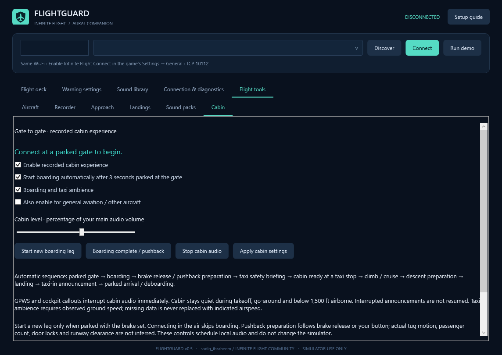

# FlightGuard

Windows companion for Infinite Flight: recorded cockpit callouts, configurable GPWS, and a cabin experience from boarding to arrival. Created for **sadiq_ibraheem** on the [Infinite Flight Community](https://community.infiniteflight.com/u/sadiq_ibraheem).

Connect your phone/tablet and Windows PC to the same Wi-Fi, start a flight and enable Infinite Flight Connect. FlightGuard discovers the local device or accepts its LAN IP. It reads [Connect v2](https://infiniteflight.com/guide/developer-reference/connect-api/connect-api) telemetry without a cloud API key or aircraft-control commands.

## Version 0.5

- Gate boarding/welcome, boarding-complete effect, safety briefing and taxi ambience.
- Cabin preparation for takeoff/landing, taxi-in announcement, doors-disarm and deboarding recordings.
- Phase-aware scheduling, separate cabin level, optional general-aviation support and manual leg controls.
- GPWS/cockpit priority: interrupt long cabin audio and discard obsolete announcements. Cabin is quiet during takeoff/go-around and below 1,500 ft airborne.
- Faster 50 ms polling target, cached sound paths and immediate playback completion scheduling. Actual sampling depends on the network/device.
- Original shield/aircraft logo and Windows icon, with community credit.
- Retains per-aircraft settings, V-speeds/minimums, local recording/replay, approach monitoring, landing reports and sound-pack repair.

**195 WAV mappings; 12 download/repair packs with 194 original clips.** No speech-synthesis fallback. Shared FlyByWire cabin recordings may contain original aircraft/airline wording. Complete OEM voices for every aircraft are not established. Windshear and spoken go-around recordings remain missing; no automatic windshear detector is claimed.



## Run

Download the Windows ZIP from Releases or a successful Windows build artifact, extract the complete folder and run `FlightGuard.exe`. No Python or separate .NET installation is required for self-contained builds. Keep the folder writable.

Open **Flight tools → Cabin**. Connect parked with the parking brake set and ground speed below 1 kt. Automatic boarding starts after three seconds. Brake release/movement progresses toward taxi and safety. Use **Start new boarding leg** or **Boarding complete / pushback** when needed. These controls schedule local audio; actual tug movement, passengers, doors and runway clearance are not inferred. Connecting in flight skips boarding.

Verify and arm V1/VR/V2 each flight. Set minimums, an approach target speed (0 disables speed checks) and minimum landing flap STATE (an index, not degrees), then Apply. Thresholds are simulator criteria, not aircraft performance data. Landing descent/bounces are sampled estimates, not impact G or runway alignment.

## Build on Windows

Requires .NET 8 SDK and Python 3 to fetch audio. Branding is checked in; regenerating it with `make_brand.py` optionally requires Pillow.

```powershell
./build.ps1 -Output ./publish/FlightGuard-v0.5-Windows
python ./fetch_sounds.py ./publish/FlightGuard-v0.5-Windows
```

The fetch scripts download pinned originals, preserve licences and generate the catalog, provenance and coverage inventory. Audio is fetched separately, rather than stored in this source repository. Keep asset/licence folders when packaging.

For a manual build, generate the coverage CSVs with `--export-coverage app-directory aircraft-reference.txt` after fetching assets. The Windows workflow does this automatically.

For CLI automation, use `Start-Process -Wait -PassThru` and check ExitCode; this is a GUI executable. Diagnostic switches:

```text
--self-test report.txt
--verify-recordings app-directory report.json
--verify-audio-priority report.json
--probe-host local-IP report.json
--analyze-recording flight.fgflight.jsonl report.json
--verify-replay flight.fgflight.jsonl report.json
--verify-pack pack-catalog.json "Shared Cabin" temporary-app-directory report.json
--make-demo-recording example-flight.fgflight.jsonl
--render-tools preview.png 5
```

Native playback diagnostics need a Windows audio device and run muted. Generated example recordings are marked synthetic. Replay disconnects live telemetry, uses recorded timestamps/settings, restores live settings and writes no aircraft profiles or new recordings. Import limits: 300 MB, 500,000 frames and 1,000,000 events. AGL/MSL are already feet; conversions apply only to speed states.

## Validation and data

v0.5 passed 109 automated checks, 195 audio decodes, an actual 11-clip cabin installer download, and an isolated 903-frame WPF replay. Live 777-200ER ground telemetry averaged 52.59 ms across 12 samples (about 19 Hz). This was not a full-flight timing test; native submission timing is not acoustic latency.

Settings, profiles, flights, landing reports and backups stay under `Data` beside the executable and are excluded from this repository. FlightGuard uploads no telemetry. Pack downloads contact pinned public source hosts when requested.

## Licences and credit

Application code and original branding: MIT, copyright Garba Ibrahim. Infinite Flight Community: **sadiq_ibraheem**. This independent app is not an Infinite Flight/manufacturer endorsement.

Audio has separate licences. FlyByWire recordings use [CC BY-NC-SA 4.0](https://github.com/flybywiresim/a32nx-wwise/blob/b4c58ff3875ef00b61a680ccbb35acc4bcebc2ef/LICENSE); FlightGear/aircraft assets have individual GPL terms. The complete audio bundle is not an unrestricted commercial library. Original WAVs, notices, revisions and SHA-256 hashes are retained. Shared sources are labelled; exact OEM authenticity is not certified.
