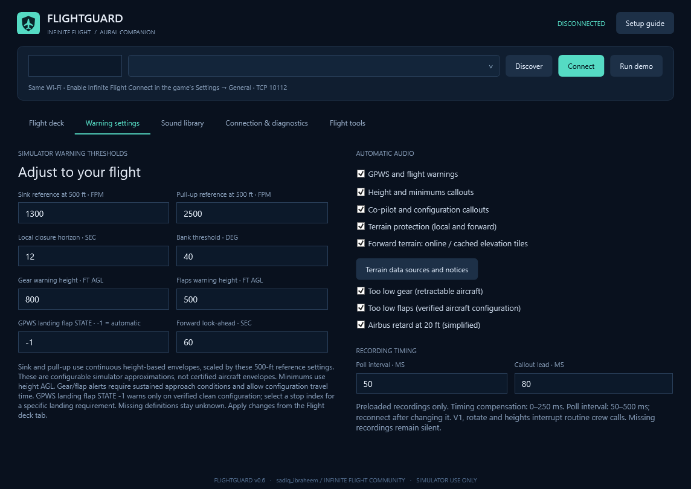

# FlightGuard

Windows companion for Infinite Flight: recorded cockpit callouts, configurable GPWS, forward terrain monitoring, and a cabin experience from boarding to arrival. Created for **sadiq_ibraheem** on the [Infinite Flight Community](https://community.infiniteflight.com/u/sadiq_ibraheem).

Connect your phone/tablet and Windows PC to the same Wi-Fi, start a flight and enable Infinite Flight Connect. Discover the local device or enter its LAN IP. FlightGuard reads [Connect v2](https://infiniteflight.com/guide/developer-reference/connect-api/connect-api) telemetry without a cloud API key or aircraft-control commands.

## Version 0.6

- Earlier default gear and flap gates: **800 ft and 500 ft AGL**, adjustable per aircraft. Persistent reminders repeat on a 1.8-second scheduling interval; a playing warning finishes before its queued repeat.
- Aircraft flap definitions use actual extension angles, including aircraft with reversed state indices. Automatic flap mode warns on verified clean configuration. Select a landing flap state to require a particular extension.
- Gear-extension and flap-travel grace, approach history, and takeoff/climb/go-around context reduce misplaced configuration alerts. Severe sink and stall protection remain active during go-around.
- Forward terrain samples cached/online elevation along GPS ground track with a default **60-second horizon** (editable 15–90). Recorded **Terrain ahead** and **Terrain ahead / pull up** clips escalate predicted conflicts.
- Local terrain closure uses a short trend window, checks MSL/AGL/vertical-speed consistency and rejects isolated AGL spikes. Warning reasons appear on the flight deck and are recorded.
- One fresh repeat survives while its warning is playing; resolved warnings are removed. GPWS interrupts lower-priority cockpit/cabin audio.
- Retains boarding, safety briefing, taxi ambience, cabin preparation, arrival/deboarding, per-aircraft preferences, V-speeds/minimums, approach monitoring, landing estimates, local recording/replay and sound-pack repair.

**197 WAV mappings; 12 download/repair packs with 194 directly downloadable original WAV clips.** Two terrain alerts are reproducible conversions of retained FlightAssistant OGG originals. No Windows speech or speech-synthesis fallback. Shared recordings and incomplete aircraft coverage are labelled. Exact OEM fidelity for every aircraft is not established; windshear and spoken go-around recordings remain missing.



## Run and tune

Download the Windows ZIP from Releases, extract the whole folder and run `FlightGuard.exe`. A self-contained build requires no Python or separate .NET installation. Keep the folder writable. Close an older FlightGuard copy before starting a newer one to avoid duplicate sound.

Open **Warning settings**. Verify gear/flap gates and V1/VR/V2 for your flight; arm speeds only after checking them. The GPWS landing flap state is an **index, not degrees**. `-1` selects automatic clean-configuration detection; an explicit state uses aircraft stop angles when available. Unknown flap definitions are shown as unverified rather than guessed. Approach-monitor flap settings are separate.

Forward terrain needs valid GPS and terrain tiles. Downloads run in the background and are cached under `Data/TerrainCache`; initial missing data and network failures are shown in status while local GPWS continues. This external elevation model can differ from Infinite Flight, lacks buildings/obstacles and runway geometry, and withholds forecasts when its current ground reference differs by more than 500 ft. It projects the current track/speed/vertical speed, not future pilot inputs. Configured normal touchdown on flat ground is inhibited. It is a simulator approximation, not certified TAWS. See [terrain sources and notices](Release/Terrain-notices/README.md).

Open **Flight tools → Cabin** at the gate, parked with brake set and below 1 kt. Boarding begins after three seconds. Use **Start new boarding leg** or **Boarding complete / pushback** when needed. Observed taxi/departure/arrival history schedules subsequent announcements; actual passengers, tug movement, doors and runway clearance are not inferred. Joining airborne skips boarding. Shared FlyByWire cabin recordings may retain their original aircraft/airline wording. Cabin stays quiet during takeoff/go-around and below 1,500 ft airborne.

## Build on Windows

Requires .NET 8 SDK and Python 3 for asset fetching. The pinned soundfile dependency converts the two retained terrain OGG originals. Branding is checked in; optional regeneration with `make_brand.py` requires Pillow.

```powershell
./build.ps1 -Output ./publish/FlightGuard-v0.6-Windows
python -m pip install -r ./requirements-audio.txt
python ./fetch_sounds.py ./publish/FlightGuard-v0.6-Windows
```

Fetch scripts preserve pinned revisions, originals, licences, provenance and SHA-256 hashes. Audio is fetched separately from the source repository. Keep `Sounds`, `SoundSources` and notices when packaging. Run `--export-coverage app-directory aircraft-reference.txt` after fetching to generate the inventory; CI does this automatically.

CLI automation should use `Start-Process -Wait -PassThru` and check ExitCode because this is a Windows GUI executable:

```text
--self-test report.txt
--verify-recordings app-directory report.json
--verify-audio-priority report.json
--verify-terrain-data temporary-cache-directory report.json
--export-coverage app-directory aircraft-reference.txt
--analyze-recording flight.fgflight.jsonl report.json
--verify-replay flight.fgflight.jsonl report.json
--verify-pack pack-catalog.json "Shared Cabin" temporary-app-directory report.json
--make-demo-recording example-flight.fgflight.jsonl
--render preview.png 1
```

Native playback checks need a Windows audio device and run muted. Generated example flights are synthetic. Replay disconnects live telemetry, performs no terrain downloads, uses recorded forward assessments when present, restores live settings and writes no aircraft profiles/new recordings. Import limits: 300 MB, 500,000 frames, 1,000,000 events. AGL and MSL are already feet; speed states alone are converted where required.

## Validation and data

v0.6 passed **141 automated checks**, **197 recorded-audio decodes**, native audio-priority checks and an isolated **903-frame WPF replay** with zero live connections and zero terrain requests. A real two-tile elevation download/decode check passed. This version has not been live flight-tested; the user chose to do that later. The 50 ms polling target depends on the game/device/network, and software audio-submission timing is not acoustic latency.

Settings, profiles, recordings, landing reports and backups stay in `Data` beside the executable and are excluded from this repository. FlightGuard sends no flight recording or API key. Enabling online terrain fetches geographic tile coordinates from AWS open elevation tiles; pack fetching contacts pinned public source hosts. Terrain notices explain the data sources and cache.

## Licences and credit

Application code/original branding: MIT, copyright Garba Ibrahim. Community credit: **sadiq_ibraheem**. Independent project; no Infinite Flight/manufacturer endorsement.

Audio has separate licences: FlyByWire recordings use CC BY-NC-SA 4.0; FlightGear/aircraft recordings carry individual GPL terms; the two new terrain clips are derived from [FlightAssistant](https://github.com/Octol1ttle/FlightAssistant/tree/266e2f2f14592737c529956273312b1dcfcfa043) under LGPL-3.0. The complete sound bundle is not an unrestricted commercial library. Original sources, notices, revisions, checksums and reproducible conversion steps are retained. OEM voice authenticity is not independently certified.
